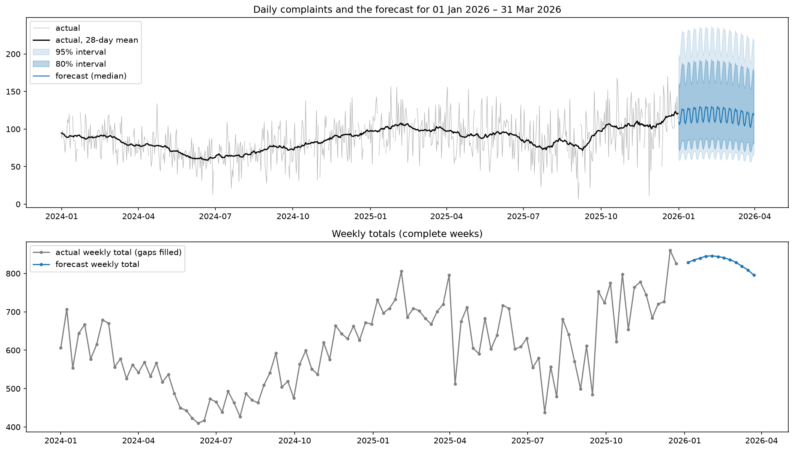

# Complaints forecast: 1 January – 31 March 2026

A daily forecast of complaints for the next 90 days, with 80% and 95% intervals and weekly totals for capacity planning, plus a pipeline that retrains it when new data arrives.

## The forecast

| | |
|---|---|
| Mean daily forecast | **118 complaints**, +17% on Jan–Mar 2025 (101) |
| Weekly totals | rise to a peak of about **845** in late January / early February, easing to about **800** by late March |
| Files | `outputs/production/forecast.csv` (daily, with intervals), `weekly_totals.csv`, `forecast.png` |



The forecast line is smoother than the history on purpose. Day-to-day spikes in this series are unpredictable noise, so the line shows the typical day and the intervals carry the spread. For planning, the weekly totals are the number to use.

## How to run it

You need Python 3.11. Create a clean environment and install the pinned packages:

```bash
conda create -n complaints-forecast python=3.11 -y   # or: python3.11 -m venv .venv
conda activate complaints-forecast                   # or: source .venv/bin/activate
pip install -r requirements.txt
```

Then, from the repo root:

```bash
python src/run_pipeline.py            # validate, clean, retrain, write a candidate forecast
python src/run_pipeline.py --promote  # after reviewing the candidate: move it to production
```

The script reads `data/raw/raw_data.csv`. It only needs two columns, `date` and `complaints`; others are ignored. It stops with a clear message if the file is missing, a required column is missing, dates can't be read or are duplicated, counts aren't whole non-negative numbers, there's less than about 2.25 years of history, or gaps are too long to fill.

The notebook, `lab/analysis_walkthrough.ipynb`, is where the analysis and every decision live. Open it from the `lab/` folder and use **Restart & Run All**.

## How new data is handled

Retraining is automated; replacing the live forecast is not. Each run:

1. Validates and cleans the new data.
2. Fits the model **without the newest 90 days** and scores it on them, alongside seasonal naive. If the production model never saw those 90 days, it's scored on them too, so the comparison is fair.
3. Refits on all the data and writes the result to `models/candidate/` and `outputs/candidate/`, with every score in `metrics.json`.

A person then reviews the candidate (the plot, the weekly totals, the scores) and runs `--promote`. Promotion refuses if the candidate didn't beat seasonal naive. The human step matters because a model can win on an average metric and still be worse where decisions are made, for example by under-forecasting the busiest days.

**Why the folders currently hold the same forecast:** no new data has arrived since the model was built, so the candidate was reviewed and promoted as is. `outputs/candidate/` and `outputs/production/` are identical, and so is the notebook's own copy (`outputs/forecast_2026Q1.csv`). You can check the script reproduces the notebook exactly:

```bash
python -c "import pandas as pd; a = pd.read_csv('outputs/forecast_2026Q1.csv'); b = pd.read_csv('outputs/production/forecast.csv'); print('identical:', a.equals(b))"
```

## Approach

**Model: dynamic harmonic regression** on log complaints:

- a linear trend (constant % growth, about 18% a year),
- one effect per weekday (Thursday to Saturday run 13–16% below Monday),
- two sine/cosine pairs for the annual cycle (about 1.5x peak to trough, peaking in late January),
- AR(1) errors, fitted with statsmodels `ARIMA` as a regression with ARIMA errors.

Intervals are widened to match the residual spread of the last 365 days, because noise has grown over time and one full-history variance would make them too narrow.

**Why this model:** the exploration found a rising trend, a weekly gradient and an annual cycle, and the forecast window sits at the seasonal peak. Dynamic harmonic regression represents all three directly, and every coefficient reads as a plain sentence. Standard automated options (ETS, ARIMA and Theta in AutoGluon) take a single seasonal period, so they can't represent both the weekly and the annual cycle.

## Evaluation

Four back-to-back 90-day windows covering 2025. Each model forecasts each window using only the data before it, with cleaning done on that training data only. Scores use recorded values only; filled days are never scored. The rules were fixed before any model was fitted.

| Model | MASE | Weekly total error | Bias | 80% / 95% coverage | 80% interval width |
|---|---|---|---|---|---|
| Seasonal naive (baseline) | 1.76 | 15.9% | +7.0% | 0.91 / 0.98 | 151% of mean |
| DHR, no annual terms | 1.56 | 17.1% | −5.7% | 0.67 / 0.88 | 62% |
| DHR | 1.41 | 11.5% | −6.0% | 0.62 / 0.80 | 51% |
| **DHR, recent-spread intervals (final)** | **1.41** | **11.5%** | **−6.0%** | **0.75 / 0.90** | **67%** |

- The final model beats seasonal naive in all four windows.
- The annual terms earn their place: without them it loses three of four windows, and the biggest gain is in W1 (January to April), the same season as the forecast. There, weekly error falls from 21% to 5%.
- Intervals are less than half as wide as the baseline's and close to target in the forecast season (0.82 / 0.94 in W1).

## Key decisions

- **Missing days:** 43 of 1,096 dates were missing. The data was put on a complete daily calendar first; treating rows as consecutive would have shifted the weekly pattern by a day.
- **Calendar flags:** the supplied bank-holiday flag was off on 3 days in 2023, so both calendar flags were rebuilt from the date and the official gov.uk list.
- **Extreme days:** 8 days were extreme even against the noise of their own period (a robust z-score above 5 against a rolling 13-week scale). They, and days with no recorded value, are filled with the median of the same weekday over the surrounding five weeks, for training only.
- **Operational columns excluded** (staffing, backlog, media mentions, channel mix): none is known for 2026, and none leads complaints once shared trend and weekly pattern are removed. Backlog moves a week *after* complaints, so it's a consequence, not a driver. `centered_7d_mean` uses future complaints, so it would leak the target.
- **Bank holidays not modelled:** they run at the same level as a normal weekday.
- **Trend specification:** the diagnostics pointed to one difference with drift, but the fitted model showed an MA term of −0.99, the classic sign of over-differencing. It was refitted with a linear trend and AR(1) errors, which converged with almost identical estimates.
- **Intervals:** the rule fixed in advance was to retrain from 2024 if coverage fell short. For the first window that would leave a single annual cycle, too little to separate the annual shape from the trend, so the intervals are rescaled to recent residual spread instead. Point forecasts are unchanged.

## Limitations

- **Likely a little low.** The model assumes constant growth, but growth accelerated in 2025. In backtests it under-forecast by about 5–6% on average, so outcomes are more likely to land above the median than below.
- **Intervals under-cover in summer** and when the forecast is biased. The forecast season is the best-behaved window.
- **Point forecasts are medians,** because the model works on the log scale. The intervals stretch further up than down for the same reason.
- **1 January is forecast as a normal Thursday.** Weekly totals have no intervals, because daily bounds don't add up to weekly ones.
- **Four windows in one year** is a small sample; differences of a few hundredths of MASE aren't meaningful.
- **Long gaps stop the pipeline.** The cleaning needs at least three of the five surrounding same weekdays, so three or more of the same weekday missing in a row makes the script stop rather than guess.

## Running this in production

- Run the pipeline when new data arrives (monthly fits the horizon well) and review before promoting.
- Track forecast against actuals weekly: bias, weekly total error and interval coverage. A sustained bias beyond about 10% or coverage well below target is the signal to revisit the model, not just retrain it.
- Revisit the trend specification if growth keeps accelerating, and consider bank-holiday effects again once more holidays are observed.

## Repo structure

```
data/raw/raw_data.csv              the supplied daily records
lab/analysis_walkthrough.ipynb     exploration, evaluation and decisions
src/run_pipeline.py                the pipeline: validate, clean, retrain, forecast, promote
models/candidate/, production/     fitted model (model.pkl) and metrics.json
outputs/candidate/, production/    forecast.csv, weekly_totals.csv, forecast.png
outputs/*_2026Q1.*                 the notebook's own copy of the forecast
requirements.txt
```

## Bonus: does a foundation model help?

The notebook's last section scores zero-shot Chronos-Bolt (small) on the same backtest. It averages MASE 1.47, beating seasonal naive with no fitting, but loses to DHR in the forecast season (1.66 vs 1.37), so DHR stays. Running that section needs `autogluon.timeseries==1.6.3` (which includes Chronos) on top of `requirements.txt`; the pipeline itself doesn't.